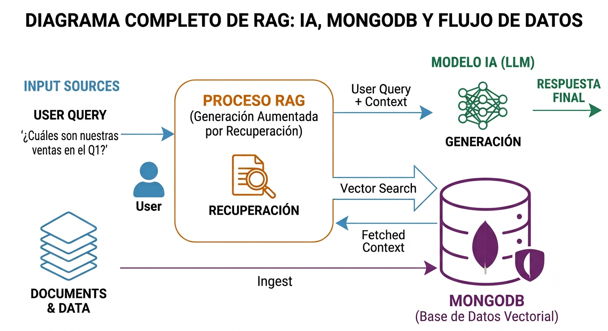
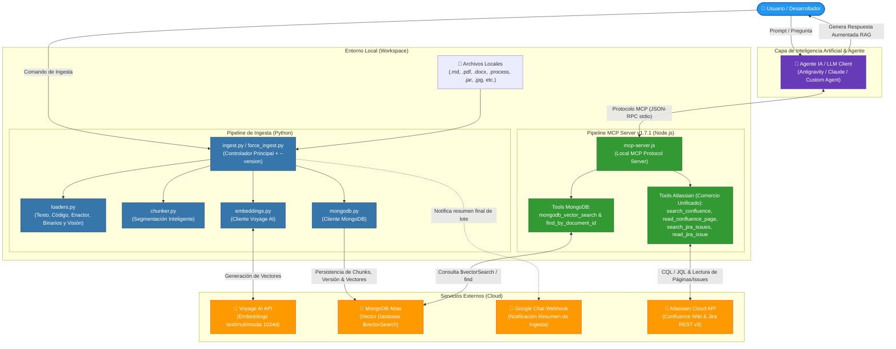
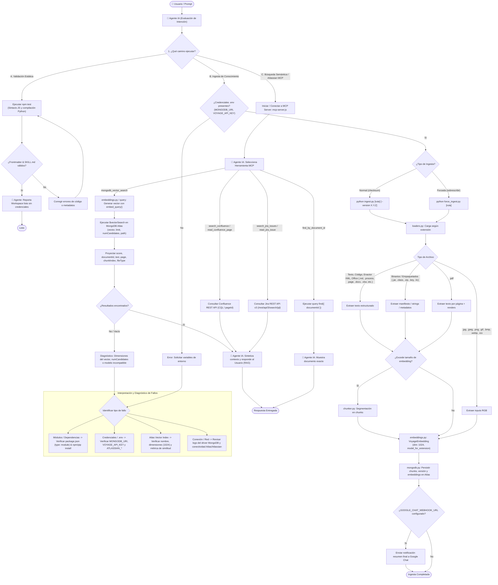
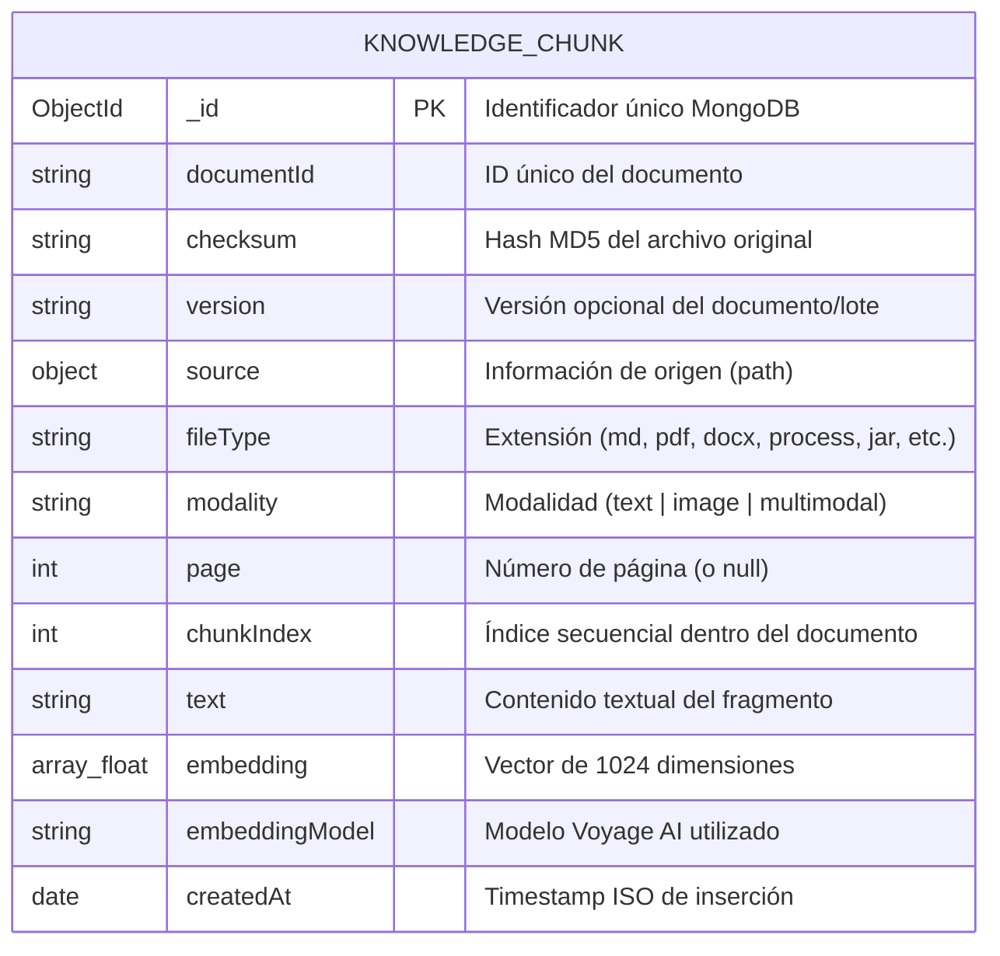

# MongoDB Vector Search Skill v1.7.1

Una skill para preparar conocimiento multimodal y multiformato, generar embeddings con Voyage AI, almacenarlos en MongoDB Atlas (con soporte de versionado) y recuperarlos con búsqueda vectorial e integración directa de solo lectura con Atlassian (Confluence y Jira, acotado automáticamente a **Comercio Unificado**) mediante un servidor MCP local.

## Propósito

Este proyecto permite:

- Ingestar documentos en formato Markdown, Texto/Código (`.txt`, `.csv`, `.xml`, `.json`, `.js`, `.html`, `.htm`, `.properties`, `.sh`, `.bat`, `.sql`, etc.), archivos empresariales Enactor (`.process`, `.page`, `.layout`, `.theme`, `.style`, `.message`, `.flf`, `.def`, `.xsd`, `.wsdl`), Office (`.docx`, `.xlsx`), PDF, imágenes (`.jpg`, `.jpeg`, `.png`, `.gif`, `.bmp`, `.webp`, `.ico`, `.svg`) y metadatos de binarios/archivos empaquetados/certificados (`.jar`, `.class`, `.zip`, `.tar`, `.gz`, `.key`, `.lic`, `.cer`, `.crt`, `.jks`).
- Etiquetar lotes de documentos con un campo de versión (`--version` / `DOCUMENT_VERSION`).
- Dividir el contenido en chunks para mejorar la recuperación semántica.
- Generar embeddings con Voyage AI (`voyage-4-large` y `voyage-multimodal-3.5`).
- Guardar los documentos y sus vectores en MongoDB Atlas con validación de cambios por checksum MD5.
- Notificar automáticamente a Google Chat (Webhook) un resumen consolidado al finalizar la ingesta o reemplazo de documentos.
- Ejecutar búsqueda vectorial (`mongodb_vector_search`), búsqueda por ID (`find_by_document_id`) y consultas en tiempo real a **Confluence** (`search_confluence`, `read_confluence_page`) y **Jira** (`search_jira_issues`, `read_jira_issue`) expuestas por `mcp-server.js`.

La idea principal es soportar un flujo completo de Retrieval-Augmented Generation (RAG), búsqueda semántica sobre repositorios/documentación técnica local y consulta directa a fuentes corporativas en Atlassian Cloud.



## ¿Cuándo usar esta skill?

Es útil cuando necesitas:

- Construir una búsqueda semántica sobre documentación técnica, bases de conocimiento empresariales (como `enactor-kb`) o repositorios internos.
- Ingestar fuentes de texto, código, configuraciones XML/XSD/WSDL, artefactos Enactor (`.process`, `.page`, `.message`, `.flf`, `.jar`, `.class`), documentos Office (`.docx`, `.xlsx`), `.pdf` o imágenes (`.jpg`, `.jpeg`, `.png`, `.gif`, `.svg`, etc.).
- Consultar páginas de **Confluence** o tickets de **Jira** desde el agente de IA mediante herramientas MCP.
- Generar embeddings para documentos y consultas con el mismo modelo y dimensiones compatibles (`1024`).
- Validar una configuración de Atlas Vector Search, embeddings, Atlassian API o MCP server.

## Requisitos

Antes de usar la skill debes tener:

- Node.js y npm instalados.
- Python 3 disponible en el entorno activo.
- Una instancia de MongoDB Atlas con soporte a Atlas Vector Search.
- Una API key válida de Voyage AI.
- (Opcional) Una cuenta y API Token de Atlassian Cloud para las herramientas de Confluence y Jira.
- Un archivo `.env` con las variables necesarias.

## Instalación

1. Instala dependencias de Node:

```bash
npm install
```

2. Instala dependencias de Python requeridas por la ingesta y los embeddings:

```bash
python3 -m pip install pymupdf pillow voyageai python-dotenv python-docx openpyxl pymongo certifi
```

3. Crea un archivo `.env` en la raíz del proyecto con variables como estas:

```env
# MongoDB configuración
MONGODB_URI="mongodb+srv://<usuario>:<password>@<cluster>/test?retryWrites=true&w=majority"
MONGODB_DB="knowledgeVectors"
MONGODB_COLLECTION="knowledge"
VECTOR_INDEX_NAME="vector_index"
VOYAGE_API_KEY="<tu_api_key>"
DOCUMENTS_PATH="/ruta/a/documentos"
DOCUMENT_VERSION="1.0.0"

# Configuración de Chunks
CHUNK_SIZE=1500
CHUNK_OVERLAP_SENTENCES=1

# Webhook para notificaciones de Google Chat
GOOGLE_CHAT_WEBHOOK_URL="https://chat.googleapis.com/..."

# Configuración de Atlassian (Confluence & Jira — Comercio Unificado)
ATLASSIAN_DOMAIN="https://tu-dominio.atlassian.net"
# ATLASSIAN_USER es opcional si utilizas un Scoped API Token (conexión Bearer vía Gateway)
# ATLASSIAN_USER="usuario@empresa.com.mx"
ATLASSIAN_API_TOKEN="<tu_atlassian_api_token>"
CONFLUENCE_ALLOWED_SPACES="CU"
JIRA_ALLOWED_PROJECTS="CM,CPI,CUD,CUQ"
```

> El archivo `.env` no debe subirse al repositorio si incluye secretos reales.

## Variables de entorno relevantes

Estas son las variables que usa el proyecto:

- `MONGODB_URI`: cadena de conexión a MongoDB Atlas.
- `MONGODB_DB`: base de datos de destino. Por defecto: `knowledgeVectors`.
- `MONGODB_COLLECTION`: colección donde se almacenan los chunks. Por defecto: `knowledge`.
- `VECTOR_INDEX_NAME`: nombre del índice vectorial en Atlas. Por defecto: `vector_index`.
- `VOYAGE_API_KEY`: clave para el servicio de embeddings de Voyage AI.
- `DOCUMENTS_PATH`: ruta por defecto para el directorio con documentos a ingerir.
- `DOCUMENT_VERSION`: versión opcional por defecto asignada a los documentos ingeridos (también configurable vía `--version`).
- `CHUNK_SIZE`: longitud aproximada de cada chunk de texto (por defecto `1500`).
- `CHUNK_OVERLAP_SENTENCES`: superposición de oraciones entre chunks (por defecto `1`).
- `GOOGLE_CHAT_WEBHOOK_URL`: (Opcional) URL del webhook de Google Chat para enviar la notificación resumen al finalizar la ingesta.
- `EMBED_BATCH_SIZE`: tamaño del lote para embedding en batch.
- `ATLASSIAN_DOMAIN`: dominio de Atlassian Cloud (ej. `https://liverpooldigital.atlassian.net`).
- `ATLASSIAN_USER`: *(Opcional con Scoped API Tokens)* correo electrónico de la cuenta de Atlassian. Si se omite o se comenta, el servidor MCP autentica automáticamente mediante `Authorization: Bearer <ATLASSIAN_API_TOKEN>` a través del Gateway de Atlassian (`api.atlassian.com`).
- `ATLASSIAN_API_TOKEN`: token de API de Atlassian para autenticar peticiones REST a Confluence y Jira (soporta tanto tokens clásicos con `Basic Auth` como **Scoped API Tokens** de solo lectura con `Bearer Auth` enrutados automáticamente vía `api.atlassian.com/ex/{product}/{cloudId}`).
- `CONFLUENCE_ALLOWED_SPACES`: lista separada por comas de claves de espacios permitidos en Confluence (por defecto `CU` — Comercio Unificado).
- `JIRA_ALLOWED_PROJECTS`: lista separada por comas de claves de proyectos permitidos en Jira (por defecto `CM,CPI,CUD,CUQ` — proyectos de Comercio Unificado).

## Flujo de trabajo y Arquitectura (Architecture & Workflow)

La arquitectura de esta skill se divide en dos fases principales: **Ingesta de Datos** (Python) y **Servidor MCP Multimodal + Atlassian** (Node.js). Ambos procesos interactúan con servicios de Inteligencia Artificial (Voyage AI), persistencia vectorial en la nube (MongoDB Atlas) y servicios corporativos (Atlassian Confluence/Jira y Google Chat).

### Diagrama de Arquitectura de la Skill



### Diagrama de Flujo de Todos los Caminos Posibles (Decision Flowchart)

El siguiente diagrama detalla todas las rutas de ejecución posibles coordinadas por el **Agente IA / Usuario**, incluyendo validación estática, ingesta multimodal/multiformato, búsqueda semántica en MongoDB, consulta a Confluence/Jira vía MCP y resolución de fallos:



El flujo principal paso a paso es el siguiente:

### 1. Preparar los documentos

El proyecto acepta una amplia variedad de formatos a través de `loaders.py`:

- **Markdown**: `.md` (procesa el texto, decodifica imágenes incrustadas en Base64 `data:image/...` y carga imágenes referenciadas localmente `` o ``).
- **Texto, Código y Configuración**: `.txt`, `.csv`, `.xml`, `.json`, `.js`, `.html`, `.htm`, `.properties`, `.sh`, `.bat`, `.sql`, `.svg`.
- **Archivos Empresariales Enactor**: `.process`, `.page`, `.layout`, `.theme`, `.style`, `.message`, `.flf`, `.def`, `.xsd`, `.wsdl`.
- **Office**:
  - `.docx`: extrae los párrafos de texto y todas las imágenes embebidas en el documento.
  - `.xlsx`: convierte las hojas y celdas en líneas de texto estructuradas.
- **PDF**: `.pdf` (cada página se convierte a bloque multimodal con texto extraído + imagen renderizada).
- **Imágenes**: `.jpg`, `.jpeg`, `.png`, `.gif`, `.bmp`, `.webp`, `.ico` (se convierten a RGB y se procesan como entrada multimodal con Voyage AI; si una imagen está corrupta o vacía, se genera un bloque descriptivo de respaldo).
- **Binarios, Empaquetados y Certificados**: `.jar`, `.war`, `.ear`, `.zip`, `.tar`, `.gz`, `.tgz`, `.class`, `.key`, `.lic`, `.cer`, `.crt`, `.jks`, `.keystore` (extrae listado de contenido interno de archivos comprimidos, cadenas legibles de bytecode `.class` o metadatos/hashes SHA-256 sin corromper el índice con bytes crudos).

### 2. Dividir contenido en chunks

`chunker.py` segmenta el texto para crear bloques manejables. El proceso genera chunks con metadata como:

- `documentId`
- `checksum`
- `version` (opcional, cuando se especifica `--version` o `DOCUMENT_VERSION`)
- `source.path`
- `fileType`
- `modality`
- `page`
- `chunkIndex`
- `text`
- `embedding`
- `embeddingModel`

La lógica de `ingest.py` evita volver a insertar archivos sin cambios usando un checksum MD5 (y si se indica `--version` sobre un documento ya existente con el mismo checksum, actualiza únicamente el campo `version` sin recalcular embeddings).

### 3. Generar embeddings

`embeddings.py` encapsula la API de Voyage AI.

El proyecto usa modelos configurados por extensión, y todos los documentos que compartan un mismo índice vectorial deben usar un modelo compatible con el mismo índice.

Modelos por defecto:

- Texto y Código: `voyage-4-large`
- Multimodal (PDF, DOCX, Markdown con imágenes, Imágenes): `voyage-multimodal-3.5`
- Dimensión del embedding: `1024`

### 4. Persistir en MongoDB Atlas

`mongodb.py` gestiona:

- conexión segura a MongoDB Atlas (con certificados TLS vía `certifi`)
- inserción masiva de documentos embebidos
- comprobación de checksums
- actualización de etiqueta `version`
- eliminación de documentos previos por `documentId` cuando cambia el contenido

### 5. Ejecutar búsqueda vectorial y herramientas Atlassian MCP

El servidor MCP se inicia con:

```bash
node mcp-server.js
```

Las herramientas disponibles en `mcp-server.js` son:

#### Herramientas de MongoDB Atlas
- **`mongodb_vector_search`**: Búsqueda semántica usando `$vectorSearch`.
  - `vector`: arreglo de números (`1024` floats) que representa el embedding de la consulta.
  - `limit`: número máximo de resultados, por defecto `5`.
  - `numCandidates`: cantidad de candidatos a evaluar, por defecto `50`.
  - `path`: campo vectorial dentro del documento, por defecto `embedding`.
  - Proyecta: `documentId`, `text`, `page`, `chunkIndex`, `fileType` y `score` (`$meta: "vectorSearchScore"`).
- **`find_by_document_id`**: Búsqueda exacta por ID de documento.
  - `documentId`: (Requerido) string que representa el ID del documento a buscar.

#### Herramientas de Atlassian (Confluence y Jira — Comercio Unificado)
> Todas las herramientas de Atlassian operan en modo **solo lectura** (`GET`), soportan **Scoped API Tokens** mediante resolución automática de `cloudId` en `api.atlassian.com` y aplican restricción obligatoria a los espacios y proyectos de **Comercio Unificado** (`CONFLUENCE_ALLOWED_SPACES="CU"` y `JIRA_ALLOWED_PROJECTS="CM,CPI,CUD,CUQ"`).

- **`search_confluence`**: Busca páginas y documentación en Confluence usando CQL (Confluence Query Language), restringido automáticamente al espacio `CU`. Distingue en cada resultado si el documento fue **Creado (`v1`)** o **Modificado (`vN`)**, junto con fecha de creación y última modificación.
  - `cql`: (Requerido) expresión CQL (ej. `type = "page" ORDER BY lastmodified DESC` o `text ~ "MongoDB"`).
  - `limit`: límite de resultados (por defecto `5`).
- **`read_confluence_page`**: Obtiene el contenido completo (limpio de etiquetas HTML) de una página de Confluence por su ID, validando previamente que pertenezca a los espacios permitidos (`CU`).
  - `pageId`: (Requerido) ID de la página de Confluence (ej. `"2823684097"`).
- **`search_jira_issues`**: Busca tickets/issues en Jira usando JQL a través del endpoint `/rest/api/3/search/jql`, restringido automáticamente a los proyectos de Comercio Unificado (`CM`, `CPI`, `CUD`, `CUQ`).
  - `jql`: consulta JQL (por defecto `updated >= -30d ORDER BY updated DESC`).
  - `limit`: máximo de issues a retornar (por defecto `5`).
- **`read_jira_issue`**: Lee el detalle completo, descripción y últimos comentarios de un ticket de Jira, validando que pertenezca a `CM`, `CPI`, `CUD` o `CUQ`.
  - `issueKey`: (Requerido) clave del ticket en Jira (ej. `"CUQ-1169"`, `"CUD-45"`).

## Ingesta de documentos

La forma más directa de procesar una carpeta nueva es:

```bash
python3 ingest.py /ruta/a/documentos
```

Si deseas etiquetar todos los documentos procesados con una **versión específica** (por ejemplo, la versión de un release o base de conocimiento):

```bash
python3 ingest.py /ruta/a/documentos --version "2.7.1784.105"
```

*(Si no pasas una ruta, el script usa `DOCUMENTS_PATH` o la ruta por defecto).*

Si deseas **forzar la actualización o re-ingesta** de una carpeta completa o un archivo que ya fue procesado (borrando la versión anterior para evitar duplicados), utiliza:

```bash
python3 force_ingest.py /ruta/a/documentos
```

Al finalizar el proceso de ingesta, se envía una **única notificación consolidada** a Google Chat (si `GOOGLE_CHAT_WEBHOOK_URL` está configurado) indicando el total de documentos nuevos, actualizados, sin cambios y la versión aplicada.

## Ejemplo de uso de embeddings

Puedes generar un embedding para una consulta con Python:

```python
from embeddings import VoyageEmbedding

voyage = VoyageEmbedding(api_key="<tu_api_key>")
query_vector = voyage.embed_query("¿Cómo funciona Atlas Vector Search?")
print(len(query_vector))
```

## Requerimientos y Definición del Índice Vectorial en Atlas

Antes de usar la búsqueda real, debes crear un índice de tipo **Atlas Vector Search** en MongoDB Atlas sobre la colección configurada (`knowledge`).

### Definición JSON del Índice Vectorial (Atlas Vector Search Index)

Crea un índice de búsqueda vectorial en MongoDB Atlas con la siguiente definición:

```json
{
  "fields": [
    {
      "type": "vector",
      "path": "embedding",
      "numDimensions": 1024,
      "similarity": "cosine"
    }
  ]
}
```

> [!IMPORTANT]
> - **Nombre del índice**: Debe coincidir con `VECTOR_INDEX_NAME` (por defecto: `vector_index`).
> - **Campo (`path`)**: `embedding`.
> - **Dimensiones (`numDimensions`)**: `1024` (producido por `voyage-4-large` y `voyage-multimodal-3.5`).
> - **Métrica (`similarity`)**: `cosine` o `dotProduct`.

---

## Esquema del Documento en MongoDB (Schema & Metadata Spec)

Cada fragmento o imagen procesada se persiste como un documento BSON con la siguiente estructura:



### Ejemplo de Documento en MongoDB:

```json
{
  "_id": { "$oid": "664b3a123f89a9c1e0123456" },
  "documentId": "manual_usuario.docx",
  "checksum": "d41d8cd98f00b204e9800998ecf8427e",
  "version": "2.7.1784.105",
  "source": {
    "path": "/ruta/a/documentos/manual_usuario.docx"
  },
  "fileType": "docx",
  "modality": "text",
  "page": 1,
  "chunkIndex": 0,
  "text": "Introducción y configuración del sistema...",
  "embedding": [0.01234, -0.05678, 0.08912, "... (1024 floats)"],
  "embeddingModel": "voyage-multimodal-3.5",
  "createdAt": "2026-10-21T18:00:00.000Z"
}
```

---

## Configuración del Cliente MCP (Agent Client Integration)

Para conectar este servidor MCP con clientes de IA (Antigravity, Claude Code, Claude Desktop, Cline, Gemini Code Assist, etc.), agrega la siguiente configuración en tu archivo de herramientas MCP (`mcp_config.json`, `claude_desktop_config.json` o `mcp_settings.json`):

```json
{
  "mcpServers": {
    "mongodb-vector-mcp": {
      "command": "node",
      "args": [
        "/ruta/absoluta/a/mongodb-vector-skill/mcp-server.js"
      ],
      "env": {
        "MONGODB_URI": "mongodb+srv://<usuario>:<password>@<cluster>/test?retryWrites=true&w=majority",
        "MONGODB_DB": "knowledgeVectors",
        "MONGODB_COLLECTION": "knowledge",
        "VECTOR_INDEX_NAME": "vector_index",
        "ATLASSIAN_DOMAIN": "https://tu-dominio.atlassian.net",
        "ATLASSIAN_USER": "usuario@empresa.com.mx",
        "ATLASSIAN_API_TOKEN": "<tu_atlassian_api_token>",
        "CONFLUENCE_ALLOWED_SPACES": "CU",
        "JIRA_ALLOWED_PROJECTS": "CM,CPI,CUD,CUQ"
      }
    }
  }
}
```

## Estructura de archivos

```text
.
├── chunker.py
├── embeddings.py
├── force_ingest.py
├── ingest.py
├── loaders.py
├── mcp-server.js
├── mongodb.py
├── package.json
├── query_mongo.js
├── query_mongo.py
├── test-find.js
├── MANUAL_INSTALACION_CONFIGURACION.md
├── README.md
└── SKILL.md
```

### Descripción por archivo

- `ingest.py`: procesa directorios recursivamente, soporta `--version`, genera embeddings e inserta en MongoDB enviando un resumen final a Google Chat.
- `force_ingest.py`: herramienta que fuerza la re-ingesta de archivos, borrando versiones o duplicados previos por nombre.
- `loaders.py`: cargadores para Markdown, PDF, Office, código/configuración, artefactos Enactor, archivos comprimidos/binarios e imágenes.
- `embeddings.py`: wrapper para Voyage AI (`voyage-4-large` y `voyage-multimodal-3.5`) y enrutamiento de modelos por extensión.
- `chunker.py`: división del texto en chunks inteligentes con superposición de oraciones.
- `mongodb.py`: operaciones de persistencia, actualización de versión y validación de checksums en MongoDB.
- `mcp-server.js`: servidor MCP que expone las herramientas de búsqueda vectorial en MongoDB Atlas y consulta de solo lectura a Confluence y Jira (acotado a Comercio Unificado).
- `SKILL.md`: definición de la skill (v1.7.1) para uso del entorno de agentes.

## Validación

Para validar el proyecto de forma estática, ejecuta:

```bash
npm test
```

Este comando comprueba:

- sintaxis JavaScript de `mcp-server.js`
- compilación de archivos Python (`chunker.py`, `embeddings.py`, `loaders.py`, `mongodb.py`, `ingest.py`) con `compileall`

## Solución de problemas

### Error de conexión a MongoDB

- Revisa que `MONGODB_URI` sea válida.
- Verifica que el cluster esté disponible y que expongas la base de datos correcta.
- Comprueba el nombre del índice vectorial.

### Error en consultas a Atlassian (Confluence / Jira)

- Verifica que `ATLASSIAN_USER` tenga el dominio completo registrado en Atlassian (por ejemplo, `.com.mx` en lugar de `.com` si aplica).
- Si utilizas un **API Token con Scopes** (`Create API token with scopes`), `mcp-server.js` detecta automáticamente el código `401` del dominio directo, resuelve el `cloudId` mediante `/_edge/tenant_info` y enruta las peticiones por `https://api.atlassian.com/ex/{confluence|jira}/{cloudId}`.
- Asegúrate de que el token tenga únicamente permisos de lectura (`read:page:confluence`, `read:confluence-content.summary`, `search:confluence`, `read:jira-work`).
- Las búsquedas y lecturas están restringidas por defecto a **Comercio Unificado** (`CONFLUENCE_ALLOWED_SPACES="CU"` y `JIRA_ALLOWED_PROJECTS="CM,CPI,CUD,CUQ"`).

### Error por falta de variables de entorno

- Asegúrate de cargar `.env` antes de ejecutar la ingesta.
- Verifica que `VOYAGE_API_KEY` y `MONGODB_URI` existan.

### Resultados vacíos o pobres

- Confirma que el modelo usado para documentos y consultas sea compatible.
- Revisa que la dimensión del vector (`1024`) coincida con la del índice.
- Mejora la calidad de los chunks o reduce la cantidad de contenido por bloque.

## Resumen

Esta skill (v1.7.1) combina:

- carga multiformato y multimodal de documentos (incluyendo bases de conocimiento completas como Enactor),
- etiquetado de versiones por lote (`--version`),
- generación de embeddings con Voyage AI,
- almacenamiento vectorial en MongoDB Atlas,
- recuperación semántica con `mongodb_vector_search` y `find_by_document_id`,
- integración directa de solo lectura con **Confluence** y **Jira** desde el mismo servidor MCP, soportando *Scoped API Tokens* y acotando automáticamente las consultas a **Comercio Unificado**.

## Formas y Recomendaciones de Uso

### Formas de Uso
1. **Invocación Directa de la Skill (`/mongodb-vector-skill`)**: Pide al agente en lenguaje natural que busque contexto técnico, ingiere una carpeta o valide la configuración.
2. **Herramientas MCP en Tiempo Real**: El agente utiliza automáticamente `mongodb_vector_search`, `find_by_document_id`, `search_confluence`, `read_confluence_page`, `search_jira_issues` y `read_jira_issue` según la consulta.
3. **Ejecución por Línea de Comandos (CLI)**: Ejecuta `python3 ingest.py /ruta --version "X.Y.Z"` para ingestas masivas incrementales o `python3 force_ingest.py /ruta` para reconstruir vectores desde cero.
4. **Flujo Híbrido (Atlassian + MongoDB Vector Search)**: Cruza normativas o tickets recientes de Confluence/Jira (Comercio Unificado) con el código y procesos almacenados en MongoDB Atlas.

### Recomendaciones Operativas (Best Practices)
- **Calibración de `$vectorSearch`**: Mantén `numCandidates` entre `10x` y `20x` el valor de `limit` (ej. `limit: 5, numCandidates: 50` para preguntas puntuales; `limit: 15, numCandidates: 150` para análisis de flujos completos). Si un fragmento relevante pertenece a un documento extenso, encadena `find_by_document_id` para recuperar todas sus páginas/chunks.
- **Reanudación tras interrupciones**: Prefiere siempre `ingest.py` sobre `force_ingest.py` en repositorios grandes; `ingest.py` verifica el `checksum` MD5 y salta en milisegundos los archivos ya procesados.
- **Tokens Atlassian de Solo Lectura y Alcance Acotado**: Utiliza *Scoped API Tokens* sin permisos de escritura (`write:*`) y mantén activas las variables `CONFLUENCE_ALLOWED_SPACES="CU"` y `JIRA_ALLOWED_PROJECTS="CM,CPI,CUD,CUQ"` en `.env`.
- **Seguridad y menor privilegio**: Nunca subas el archivo `.env` con secretos reales al repositorio y utiliza usuarios de MongoDB con rol `readWrite` (ingesta) o `read` (consulta MCP) acotados a `knowledgeVectors`.

## Referencias internas

- `SKILL.md`: especificación de la skill v1.7.1.
- `MANUAL_INSTALACION_CONFIGURACION.md`: manual completo de instalación, configuración, formas de uso y recomendaciones bajo el framework Diátaxis.
- `mcp-server.js`: servidor MCP con herramientas de MongoDB Atlas, Confluence y Jira.
- `ingest.py`: flujo principal de ingesta y embeddings.
