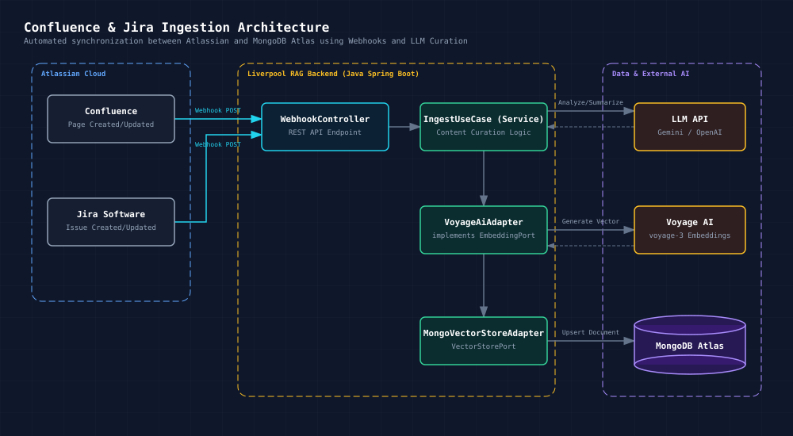

# Confluence & Jira Ingestion Architecture

Este documento describe la arquitectura para ingestar y mantener actualizada la Bóveda de Conocimiento (MongoDB Atlas Vector Search) basándose en eventos de Atlassian (Jira y Confluence).

## 1. Visión General

El sistema utiliza un enfoque basado en eventos (Webhooks) para sincronizar en tiempo real los cambios en la documentación (Confluence) y tickets (Jira) con nuestra base de datos vectorial en MongoDB Atlas. Para asegurar la calidad de la información, un modelo de lenguaje (LLM) curará el contenido antes de generar los embeddings.

## 2. Diagrama de Arquitectura

El siguiente diagrama ilustra el flujo de datos:

## 3. Componentes Principales

### 3.1. Orígenes (Atlassian Cloud)

* **Confluence:** Se configura un Webhook que se dispara en los eventos `page_created` y `page_updated`.
* **Jira Software:** Se configura un Webhook que se dispara en los eventos `jira:issue_created` y `jira:issue_updated`.

### 3.2. Receptor (Liverpool RAG Backend)

El backend actual en Java Spring Boot (`api_backend`) se ampliará para recibir estos eventos.

* **`WebhookController`:** Un nuevo controlador REST (ej. `POST /api/v1/webhooks/atlassian`) que escuchará las peticiones entrantes. Valida la firma del webhook y enruta el payload al servicio adecuado.
* **`IngestUseCase` (Servicio):** La lógica de negocio principal. Al recibir un ID de página o ticket, utilizará la API REST de Atlassian para recuperar el contenido completo actualizado.

### 3.3. Curación y Embeddings (Capa de IA)

* **Curación por LLM:** Antes de ingestar, el texto crudo se envía a un LLM (Gemini u OpenAI). El LLM se encargará de:
  * Limpiar el ruido (ej. firmas de correo, menús de navegación extraídos por error).
  * Resumir hilos largos de comentarios en Jira.
  * Extraer metadatos semánticos (tags, entidades clave) para enriquecer el filtrado en MongoDB.
  * Descartar actualizaciones triviales (ej. correcciones ortográficas menores) para ahorrar costos de embeddings.
* **Generación de Vectores:** Utilizando el `VoyageAiAdapter` existente, se generarán los embeddings (representaciones vectoriales) del texto curado.

### 3.4. Almacenamiento (Data Layer)

* **MongoDB Atlas:** A través del `MongoVectorStoreAdapter`, el documento (texto + vector + metadatos) se inserta o actualiza (`upsert`) en la colección de la bóveda de conocimiento, quedando inmediatamente disponible para búsquedas semánticas.

## 4. Flujo de Procesamiento (Paso a Paso)

1. **Evento:** Un usuario edita una página en Confluence.
2. **Notificación:** Confluence envía un HTTP POST al `WebhookController` con el ID de la página.
3. **Extracción:** El backend consulta la API de Confluence para descargar el nuevo contenido Markdown/HTML de esa página.
4. **Curación:** El backend envía el contenido al LLM con un prompt del estilo: *"Resume esta documentación técnica y extrae las entidades principales..."*.
5. **Vectorización:** El resumen/texto curado se envía a Voyage AI para obtener su array de floats (embedding).
6. **Ingesta:** El documento estructurado se actualiza en MongoDB Atlas utilizando el ID original de la página de Confluence como clave única.

## 5. Próximos Pasos para la Implementación

Para llevar esto a cabo en tu código actual, se requiere:

1. Crear la clase `WebhookController.java` en `src/main/java/com/liverpool/rag/infrastructure/in/web/`.
2. Crear las clases de DTO (Data Transfer Object) para parsear los payloads JSON de Jira y Confluence.
3. Implementar un cliente HTTP (ej. `WebClient` o `RestTemplate`) para consultar las APIs de Atlassian.
4. Exponer el endpoint públicamente (o configurar un túnel/ngrok para pruebas locales) y registrar la URL en la configuración de Webhooks de Jira/Confluence.
